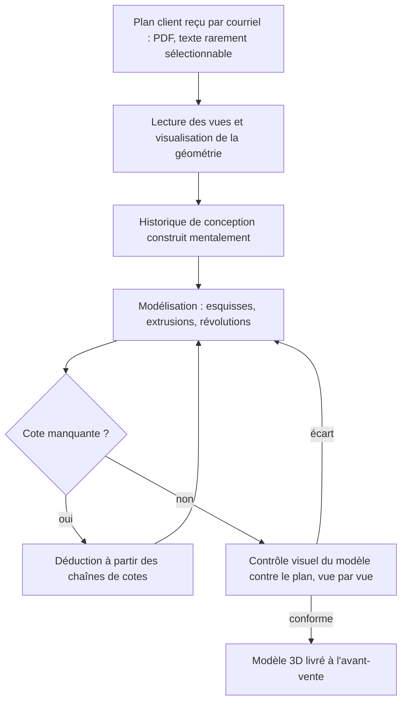

# Rapport de conduite de projet : agent d'ingénierie inverse

## 1. Contexte et analyse des besoins

### 1.1 Présentation du contexte

#### Le besoin métier

Dans l'industrie, les échanges entre entreprises passent encore largement par des plans 2D, papier ou PDF : les logiciels de CAO et leurs versions diffèrent d'un partenaire à l'autre, et le plan reste le format commun. Quand le destinataire a besoin du modèle 3D d'une pièce, pour la fabriquer, la modifier ou la présenter, il doit le reconstruire à la main à partir du plan.

Le contexte retenu est celui de l'ameublement et de la conception bois, que l'auteur connaît par son parcours en bureau d'études et chez EFICAD. EFICAD édite une suite de compléments à SolidWorks pour la conception paramétrique et la fabrication dans l'industrie de l'ameublement. Chez EFICAD, la reconstruction 3D sert l'avant-vente : l'équipe modélise la pièce d'un prospect à partir de ses plans, pour lui faire une démonstration sur son propre modèle.

#### Maturité IA

Le processus est entièrement manuel, et aucun outil d'automatisation n'est en usage chez EFICAD (§1.2, Q7). Un outil d'IA dédié à cette tâche existe depuis peu dans SolidWorks. Selon l'interlocuteur, EFICAD, éditeur de compléments et non de SolidWorks lui-même, n'est pas autorisé à l'utiliser. La maturité IA sur ce processus est donc nulle pour cet acteur, alors qu'une solution existe dans son écosystème.

#### Contraintes

- **Confidentialité** : les plans clients sont sensibles, avec un niveau d'exigence élevé et des règles qui varient d'un client à l'autre (Q9, Q10). L'envoi d'un plan à un modèle hébergé hors de l'entreprise n'est donc pas neutre.
- **Format de sortie** : le STEP est le format le plus exploitable (Q11).
- **Matériel** : l'exécution locale d'un modèle de vision est bornée par un GPU de 8 Go de VRAM, contrainte traitée au §3.

### 1.2 Collecte et analyse du besoin métier

#### Méthode et partie prenante

Le besoin a été recueilli le 8 septembre 2026 à 16 h, par un entretien individuel sur un questionnaire ouvert de 13 questions préparées à l'avance. L'interlocuteur est Olivier Guérin, manager technique d'EFICAD, qui a accepté d'être nommé. L'expérience de l'auteur en CAO sert de seconde source, notamment pour les ordres de grandeur du §2. Dans ce rapport, Qn renvoie au numéro de la question.

Limite assumée : un seul interlocuteur, dans une seule entreprise, et des réponses déclaratives. Les chiffres qui en sont tirés sont des estimations d'un praticien, pas des mesures.

#### Ce que dit l'entretien

- **Processus** (Q1) : entièrement manuel dans SolidWorks. Esquisses, puis extrusions, balayages ou révolutions, en alternant lecture du plan et modélisation.
- **Fréquence et acteurs** (Q2, Q4) : environ une fois par mois. L'équipe d'avant-vente s'en charge elle-même, à partir des plans du client.
- **Durée** (Q3) : non chiffrée par l'interlocuteur, qui la dit très dépendante de la complexité de la pièce.
- **Coût principal** (Q5) : la modélisation, plus que la lecture du plan ou la ressaisie des cotes.
- **Défaillance principale** (Q6) : les cotes manquantes sur le plan.
- **Qualité des plans** (Q8) : en général des PDF plutôt bien normalisés, avec trois vues et parfois une vue isométrique, mais une qualité variable.
- **Seuil d'acceptabilité** (Q12) : un modèle correct à 95 % serait « très utile », car « une grande partie de la tâche est de vérifier ». Le seuil plancher n'a pas été chiffré.
- **Cible de valeur** (Q13) : les pièces complexes, plutôt que les pièces simples et répétitives.

#### Hiérarchisation des besoins

| Besoin | Source | Impact | Effort | Traitement dans le projet |
|---|---|---|---|---|
| Sortie STEP exploitable | Q11 | fort | faible | couvert |
| Automatiser la modélisation | Q5 | fort | moyen | couvert sur la géométrie bornée du §1.3 |
| Faciliter la vérification humaine | Q12 | fort | moyen | partiel : conformité mesurée contre une vérité terrain en évaluation seulement, perspective au §6 |
| Garantir la confidentialité des plans | Q9, Q10 | fort, bloquant selon le client | élevé | non couvert par le POC, comparatif au §3 |
| Signaler les cotes manquantes | Q6 | fort | élevé | hors périmètre |
| Traiter les pièces complexes | Q1, Q13 | fort | élevé | hors périmètre, phase ultérieure |
| Accepter des plans de qualité variable | Q8 | moyen | élevé | hors périmètre après le test de la pièce C |

Le projet traite d'abord les besoins à fort impact et à effort faible ou moyen. Les besoins à fort impact et à effort élevé sont documentés et reportés, pas ignorés.

### 1.3 Périmètre retenu

- **Géométrie** : contours extrudés, trous traversants et borgnes, poches rectangulaires. Sont exclus les congés, les filetages, les révolutions et les assemblages.
- **Entrée** : plans PDF propres et normalisés, ce qui correspond au cas général décrit en Q8. Cette restriction découle du test de la pièce C (T28), un plan réaliste avec cartouche, tolérances et chaînes de cotes, et de la règle d'interprétation fixée avant son exécution. C'est une décision de cadrage, pas un échec du projet.
- **Sortie** : un fichier STEP.
- **Modèle** : un modèle de vision appelé par API, sur des plans non confidentiels dessinés ou redessinés par l'auteur. Un usage sur des plans clients suppose de lever la contrainte de confidentialité (§3).

Tension assumée : l'entretien place la valeur sur les pièces complexes (Q13), et le processus réel mobilise des balayages et des révolutions (Q1), exclus ici. Le projet est une preuve de faisabilité de la chaîne complète (lecture du plan, primitives, génération, vérification) sur une géométrie bornée. Il ne démontre pas la valeur métier sur les pièces complexes, qui relève d'une phase ultérieure.

## 2. Audit de la solution existante : le processus manuel de remodélisation

### 2.1 Solution actuelle

#### Flux et outils

La solution existante n'est pas un pipeline de données : c'est un flux humain, entièrement manuel, décrit ici d'après l'entretien (Q1, Q4) et l'expérience de l'auteur.

1. **Réception** : le plan arrive par courriel, le plus souvent en PDF. Le texte y est rarement sélectionnable, ce qui interdit une extraction automatique simple des cotes.
2. **Lecture** : le plan est affiché sur un écran, le logiciel de CAO sur l'autre, SolidWorks chez EFICAD. L'opérateur étudie les vues pour se représenter la pièce dans l'espace. Une vue isométrique, quand elle existe, facilite cette étape.
3. **Planification** : l'opérateur construit mentalement l'historique de conception, de la fonction de base (extrusion ou révolution) aux fonctions qui en dérivent. Ce plan de construction n'est écrit nulle part.
4. **Modélisation** : esquisse sur un plan, puis déroulé de l'historique. C'est à cette étape que les cotes sont lues, que les chaînes de cotes sont reconstituées et que les cotes manquantes sont déduites.
5. **Contrôle** : allers-retours continus entre le modèle et le plan, vue par vue, jusqu'à concordance des dimensions et de la forme.

Outils : un logiciel de CAO dont la licence est déjà acquise, une visionneuse PDF, deux écrans. Aucun script ni outil d'IA (Q7).

### 2.2 Évaluation de l'adéquation aux besoins

#### Visualisation du flux

#### Critères d'analyse

| Critère | Processus manuel | Limite |
|---|---|---|
| Délai par pièce | environ 30 min pour une pièce simple comparable au corpus du projet, contrôle compris ; jusqu'à 2 h pour une pièce complexe ; davantage pour un assemblage (estimations de l'auteur, Q3 n'ayant pas été chiffrée) | temps d'un opérateur qualifié immobilisé à chaque pièce |
| Coût | temps opérateur uniquement, la licence CAO étant déjà acquise ; la modélisation est le poste principal (Q5) | coût proportionnel au nombre et à la complexité des pièces |
| Volume | environ une pièce par mois chez EFICAD (Q2), soit de l'ordre de 6 à 24 h par an (calcul de l'auteur sur les deux estimations précédentes) | gain automatisable modeste en heures pour cet acteur |
| Robustesse | dépend de l'attention et de l'expérience de l'opérateur ; défaillance principale : les cotes manquantes, déduites à la main (Q6) | aucune garantie reproductible |
| Contrôle | allers-retours visuels entre modèle et plan, qui constituent une grande part du travail (Q12) | aucune trace, aucun critère mesurable, aucune grandeur volumique contrôlée |
| Couverture géométrique | totale : révolutions, balayages, assemblages (Q1) | aucune, c'est un point fort |
| Sécurité et confidentialité | le plan ne quitte jamais le poste de travail | aucune, conforme aux exigences clients (Q9, Q10) : c'est un point fort |
| Maintenance | aucun outil à maintenir | le savoir-faire reste individuel et non capitalisé |

#### Écarts et limites

- **Le coût est dans la modélisation et le contrôle, pas dans la lecture** (Q5, Q12). Une automatisation limitée à l'extraction des cotes traiterait l'étape la moins coûteuse. La cible doit produire le modèle et en outiller le contrôle.
- **Le contrôle n'est ni tracé ni mesurable.** Rien ne distingue un modèle contrôlé d'un modèle qui ne l'a pas été, et la conformité repose sur l'appréciation visuelle d'une seule personne.
- **Le plan de construction n'est pas capitalisé.** Il est reconstruit mentalement à chaque pièce, puis perdu.
- **Le gain en heures est modeste chez EFICAD** au volume actuel. La valeur est à chercher dans la réactivité de l'avant-vente, sur les pièces complexes (Q13) et chez des acteurs qui remodélisent plus souvent. Ce point est repris dans l'aide à la décision (§4.2).

Deux points forts du processus manuel sont à préserver : la confidentialité totale et la couverture géométrique complète. Toute solution cible qui recule sur l'un d'eux doit l'assumer explicitement (§3).

## 5. Contrôle et suivi

Le projet est piloté par budgets fixes et règles décidées d'avance : le périmètre s'ajuste au temps disponible, jamais l'inverse. Chaque règle d'arrêt a été écrite avant la mesure qui pouvait la déclencher.

### 5.1 Tableau de bord de pilotage

#### Indicateurs

| Indicateur                | Cible fixée d'avance | Réalisé | Source |
|---------------------------|---|---|---|
| Délai                     | Fin des travaux visée du 18 au 22/09 | Deux jours d'avance sur le planning au 11/09             | Horodatage des commits |
| Coût, projet 15 entier    | 47 à 55 h, planifié 55,5 h           | 28,9 h réelles pour 41,5 h estimées au 10/09, ratio 70 % | CSV de suivi           |
| Coût, projet libre        | Créneau fixe de 20 h                 | Clos à 12,7 h le 11/09, 7,3 h rendues au calendrier      | CSV, blocs 1 à 7       |
| Coût, spike               | 5 h, arrêt dur à 5 h 30              | 2,5 h                                                    | [Verdict du spike](verdict_spike.md) |
| Livrables du projet libre | Blocs 1 à 7 du cadrage               | Tous livrés, dépôt publié et tagué `v0.1.0`              | Dépôt                  |
| Performance               | Seuils C1 à C3 figés au spike        | C2 : 5 sur 5 ; C3 : 4 sur 5                              | [Rapport d'évaluation](rapport_evaluation.md), section 2 |

L'unité de coût suivie est l'heure de travail. Le CSV de suivi porte, pour chaque tâche, l'estimé, le réel, l'écart et le statut ; il est joint en annexe. [Chiffres finaux à la clôture.]

#### Ce que le suivi a appris : le prédicteur des écarts

Sur le créneau du projet libre, le rapport entre réel et estimé suit la quantité de code réellement nouveau. Les tâches sans code nouveau sortent très sous l'estimation : 29 % et 35 % pour les runs de bout en bout, 25 % pour le README. La règle d'arrêt de la boucle de reprise, seule notion inconnue au départ, sort à 144 %. Les tâches de rédaction du rapport d'évaluation restent proches de l'estimation (84 % et 101 %), avec une part de latence de génération que les estimations n'intégraient pas. Ce constat alimente les estimations des projets suivants.

#### Méthode de gestion

- **Pilotage à trois niveaux.** Une feuille de route globale fixe le budget et l'ordre des projets de la formation. Un brief par projet fixe budget, périmètre et définition de terminé ; le projet 15 en a reçu deux, le second émis après le verdict du spike. Le niveau projet produit le planning jour par jour et le CSV de suivi, chaque journée s'exécute contre ce plan et en remonte les temps réels. La capacité hebdomadaire, planifiée d'abord à 35 h, a été corrigée en cours de formation à 19 h, valeur observée.
- **Deux étiquettes par tâche.** La priorité : essentielle, requise pour la validation, ou secondaire, première à sauter en cas de dépassement. La catégorie, qui fixe l'effort d'apprentissage et non l'importance : ancrage (notion à maîtriser, produite par l'auteur en trois jets), compréhension (un jet, puis solution expliquée), utilitaire (plomberie, reçue directement).
- **Créneau fixe.** Le projet libre dispose de 20 h, décidées avant le spike et indépendamment de son résultat. Le périmètre géométrique est borné en conséquence ; toute addition impose une coupe équivalente.
- **Coupe-circuit à 150 %.** Une tâche qui atteint 150 % de son estimation s'arrête : une version minimale qui satisfait la définition de terminé est livrée et le point est noté. Distinct du plafond de 30 à 40 minutes par blocage, au-delà duquel la solution complète est demandée.
- **Revue hebdomadaire du vendredi.** Cumul réel contre prévu, débit effectif, date de fin projetée.
- **Jalon de bascule du 14/09.** Contrôle sur les heures produites, pas sur l'avancement : sous 30 h cumulées sur les deux premières semaines, replanification automatique à 12 h par semaine, non renégociable. [Verdict du jalon.]
- **Arbitrages écrits.** Chaque décision est tranchée, motivée et non rouverte. Exemples : la vérification géométrique reste hors de la boucle de reprise ; les prompts sont gelés ; la pièce B, non conforme, n'est ni relancée ni corrigée ; le jeu tenu à l'écart, une fois consommé, n'autorise plus aucun ajustement.

#### Le spike, instrument de décision

Avant tout développement, un spike a acheté l'information qui manquait : l'extraction de cotes par un modèle de vision est-elle assez fiable pour fonder le projet ?

- **Cadre fixé avant exécution** : budget de 5 h, arrêt dur à 5 h 30 ; trois critères avec leurs seuils ; matrice de décision écrite ; projet de repli désigné d'avance, pour ne pas le choisir sous la pression d'un échec.
- **Seuil appliqué à la lettre** : C1 échoue, 2 erreurs sur B contre 1 tolérée, et le seuil n'est pas réinterprété. C2 et C3 sont acquis. Consommé : 2,5 h.
- **Décision par la cause, pas par le taux** : la matrice exigeait de qualifier la nature des erreurs. Cette qualification fonde un GO argumenté (verdict, sections 3 et 5).
- **Test de falsification** : une pièce réaliste, exécutée ensuite sur le reliquat du budget, était le seul test capable de renverser le GO. L'interprétation de son résultat avait été fixée avant le test ; il a conduit à restreindre l'entrée aux plans propres et normalisés.

Le verdict est joint tel quel en annexe : [`verdict_spike.md`](verdict_spike.md).

### 5.2 Outils et process de suivi

#### Journalisation

- **Traces d'évaluation** (`evaluations/`, versionnées) : une trace JSON par run, avec le plan, la référence, le modèle, les primitives extraites, le nombre de tentatives, le message d'erreur éventuel, les mesures des deux solides et le verdict par contrôle. Une trace est écrite même sans fichier produit.
- **Artefacts** (`artifacts/`, non versionnés) : primitives, script de chaque tentative et STEP produit, horodatés.

#### Méthodologie de test

- **Tests de fumée** (`tests/`). `smoke_mcp.py` vérifie le serveur MCP : poignée de main, liste des outils, un succès et un échec attendus. `smoke_pipeline_exit.py` exerce les trois arrêts de la boucle de reprise sur le vrai pipeline, attendus figés avant exécution : 3 conformes sur 3, sans modifier `agent.py`.
- **Sandbox** : le script généré s'exécute dans un conteneur Docker jetable, sous un utilisateur non root, avec un délai borné et le seul répertoire de travail monté. Le succès se lit dans le fichier produit, jamais dans le code de retour.
- **Évaluation de bout en bout** : `evaluer.py` confronte chaque solide produit au STEP de référence sur cinq contrôles, aux tolérances figées au spike, une pièce par processus.
- **Jeu tenu à l'écart** : deux pièces jamais vues pendant le développement, exécutées une seule fois, sous une règle de relance figée avant le premier run et restée inutilisée. Aucun ajustement après lecture : les taux restent comparables.
- **Hors périmètre** : ni suite de tests unitaires, ni tests de charge, ni monitoring de production de type Prometheus ou Grafana. Le projet est une preuve de concept sans déploiement ; le suivi en usage relève des perspectives (section 6).

#### Traçabilité

Un commit atomique par tâche. Le code des runs mesurés est celui du commit `2143428` ; le tag `v0.1.0` marque l'état livré, les commits postérieurs ne touchant que la documentation et le suivi git.